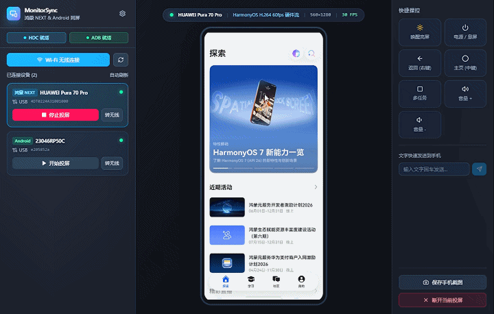

<div align="center">

# MonitorSync

**Low-latency PC-to-Phone screen mirroring and remote control for HarmonyOS NEXT (HDC) and Android (ADB / scrcpy).**

[](https://github.com/starraiser24-source/MonitorSync/actions/workflows/ci.yml)
[](https://github.com/starraiser24-source/MonitorSync/releases)
[](./LICENSE)

**English** | [简体中文](./README_CN.md)

<br />



</div>

---

## Features

- **Dual-Ecosystem Support**
  - **HarmonyOS NEXT (HDC)**: Native C++ `harmony-agent` using `AVScreenCapture` + hardware H.264 encoding over HDC for smooth 60fps screen mirroring and remote touch/keyboard control — a *scrcpy-like* experience for HarmonyOS NEXT.
  - **Android (ADB / scrcpy)**: Connects via ADB and the `scrcpy-server` protocol for hardware-accelerated H.264 streaming and full touch, key, scroll, and text input control.
- **USB & Wi-Fi Wireless Connections**: Works seamlessly over USB cables or local Wi-Fi debugging.
- **Hardware-Accelerated WebCodecs Rendering**: Decodes H.264 frames directly in the Electron renderer via WebCodecs + Canvas for ultra-low latency.
- **Customizable Controls & Paths**: Configure `hdc`, `adb`, and `scrcpy-server` paths, plus resolution, bitrate, and FPS directly in Settings.

---

## Download

Prebuilt Windows installers (`.exe`) and portable archives (`.zip`) are published on the [GitHub Releases](https://github.com/starraiser24-source/MonitorSync/releases) page.

---

## Requirements

- **Node.js**: >= 20.x (for building from source)
- **For Android**:
  - [Android Platform Tools](https://developer.android.com/tools/releases/platform-tools) (`adb`)
  - `scrcpy-server` binary from [Genymobile/scrcpy Releases](https://github.com/Genymobile/scrcpy/releases) (v3.1 recommended)
- **For HarmonyOS NEXT**:
  - [DevEco Studio](https://developer.huawei.com/consumer/en/deveco-studio/) / OpenHarmony SDK (`hdc`)
  - A HarmonyOS NEXT device (API 12+) with Developer Mode & USB Debugging enabled

---

## Quick Start (From Source)

### 1. Clone and install dependencies

```bash
git clone https://github.com/starraiser24-source/MonitorSync.git
cd MonitorSync
npm install
```

### 2. Prepare external binaries (as needed)

External binaries are not tracked in Git:

- **Android (`scrcpy-server`)**
  1. Download `scrcpy-server` (recommended: `v3.1`) from [Genymobile/scrcpy Releases](https://github.com/Genymobile/scrcpy/releases).
  2. Place it at `resources/bin/scrcpy-server` (or specify its path in the in-app **Settings**).
- **HarmonyOS NEXT (`harmony-agent`)**
  1. Copy the config template:
     ```bash
     cp harmony-agent/build-profile.example.json5 harmony-agent/build-profile.json5
     ```
  2. Open `harmony-agent/` in **DevEco Studio**.
  3. Go to `File -> Project Structure -> Signing Configs` and check **Automatically generate signature** to create a local debug signature (required by HarmonyOS NEXT app installation security).
  4. Build and install `harmony-agent` onto your HarmonyOS NEXT device.

> `hdc` and `adb` are automatically detected if they are on your system `PATH` or installed in default SDK locations. You can also place them in `resources/bin/` or configure custom paths in Settings.

### 3. Run, test, and package

```bash
# Start in development mode
npm run dev

# Typecheck
npm run typecheck

# Run unit tests
npm test

# Build production bundle
npm run build

# Package Windows installer (.exe) and portable (.zip) into dist/
npm run dist:win
```

---

## Project Structure

```text
MonitorSync/
├── src/
│   ├── main/           # Electron main process (HDC/ADB drivers, WebSocket stream server, settings)
│   ├── preload/        # Electron preload bridge
│   ├── renderer/       # React + Tailwind CSS UI and WebCodecs H.264 / JPEG renderers
│   └── shared/         # Shared IPC and protocol types
├── harmony-agent/      # HarmonyOS NEXT native screen streamer (ArkTS + C++ NDK)
├── resources/bin/      # Local external binaries directory (gitignored)
├── docs/               # Documentation and demo assets
└── tests/              # Vitest unit tests
```

---

## Acknowledgements

- Android mirroring is compatible with and invokes `scrcpy-server` from [Genymobile/scrcpy](https://github.com/Genymobile/scrcpy) (Apache-2.0 License).

---

## License

Licensed under the [MIT License](./LICENSE).
