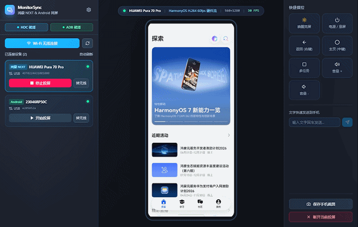

<div align="center">

# MonitorSync

**支持 HarmonyOS NEXT (HDC) 与 Android (ADB / scrcpy) 的低延迟桌面投屏与远程控制工具。**

[](https://github.com/starraiser24-source/MonitorSync/actions/workflows/ci.yml)
[](https://github.com/starraiser24-source/MonitorSync/releases)
[](./LICENSE)

[English](./README.md) | **简体中文**

<br />



</div>

---

## 功能特性

- **双平台支持**
  - **HarmonyOS NEXT (HDC)**：配合原生 C++ `harmony-agent`（`AVScreenCapture` + 硬件 H.264 编码）与 HDC 通道，实现 60fps 低延迟投屏与远程触控/键盘控制，提供类似“鸿蒙版 scrcpy”的体验。
  - **Android (ADB / scrcpy)**：基于 ADB 与 `scrcpy-server` 协议实现 H.264 视频流硬解与触控、按键、滚轮、文本输入控制。
- **USB & Wi-Fi 无线连接**：支持数据线直连与局域网无线调试连接。
- **WebCodecs 流畅渲染**：渲染端通过 WebCodecs H.264 解码与 Canvas 绘制，低延迟且流畅。
- **灵活配置**：支持在应用内自定义 `hdc`、`adb` 与 `scrcpy-server` 路径，以及分辨率、码率、帧率等投屏参数。

---

## 直接下载使用

前往 [GitHub Releases](https://github.com/starraiser24-source/MonitorSync/releases) 下载已构建好的 Windows 安装包（`.exe`）或绿色便携版（`.zip`）。

---

## 环境要求

- **Node.js**：>= 20.x（仅从源码构建时需要）
- **Android 投屏**：
  - [Android Platform Tools](https://developer.android.com/tools/releases/platform-tools)（`adb`）
  - [scrcpy](https://github.com/Genymobile/scrcpy/releases) 服务端文件 `scrcpy-server`（推荐 **v3.1**）
- **HarmonyOS NEXT 投屏**：
  - [DevEco Studio](https://developer.huawei.com/consumer/cn/deveco-studio/) 及 OpenHarmony / HarmonyOS SDK（提供 `hdc` 工具链）
  - 搭载 HarmonyOS NEXT（API 12+）的真机并开启开发者模式与 USB 调试

---

## 从源码快速开始

### 1. 克隆项目并安装依赖

```bash
git clone https://github.com/starraiser24-source/MonitorSync.git
cd MonitorSync
npm install
```

### 2. 准备外部二进制文件（按需）

仓库不包含第三方二进制文件，请按使用场景准备：

- **Android（`scrcpy-server`）**
  1. 前往 [Genymobile/scrcpy Releases](https://github.com/Genymobile/scrcpy/releases) 下载对应版本（推荐 `v3.1`）的 `scrcpy-server`。
  2. 将文件放置到 `resources/bin/scrcpy-server`（或在应用「设置」中指定自定义路径）。
- **HarmonyOS NEXT（`harmony-agent`）**
  1. 复制配置模板：
     ```bash
     cp harmony-agent/build-profile.example.json5 harmony-agent/build-profile.json5
     ```
  2. 使用 **DevEco Studio** 打开 `harmony-agent/` 目录。
  3. 在 `File -> Project Structure -> Signing Configs` 中勾选 **Automatically generate signature** 完成本地调试签名（受 HarmonyOS NEXT 安全机制要求，真机安装必须签名）。
  4. 连接 HarmonyOS NEXT 设备，构建并安装 `harmony-agent` 到手机端。

> `hdc` 与 `adb` 只要已加入系统 `PATH`（或安装在默认 SDK 目录），应用即可自动识别；也可直接放到 `resources/bin/` 或在应用内「设置」中手动指定路径。

### 3. 启动开发、测试与打包

```bash
# 启动开发模式
npm run dev

# 类型检查
npm run typecheck

# 运行单元测试
npm test

# 构建生产产物
npm run build

# 打包 Windows 安装包 (.exe) 与绿色便携版 (.zip) 到 dist/
npm run dist:win
```

---

## 项目结构

```text
MonitorSync/
├── src/
│   ├── main/           # Electron 主进程（HDC / ADB 驱动、WebSocket 流服务、配置存储）
│   ├── preload/        # Electron Preload 桥接层
│   ├── renderer/       # React + Tailwind CSS 前端界面与 WebCodecs H.264 / JPEG 渲染器
│   └── shared/         # 跨进程共享类型定义
├── harmony-agent/      # HarmonyOS NEXT 原生录屏推流端（ArkTS + C++ NDK）
├── resources/bin/      # 本地外部二进制目录（被 .gitignore 忽略）
├── docs/               # 文档与演示动图
└── tests/              # Vitest 单元测试
```

---

## 致谢

- Android 投屏协议兼容并调用 [Genymobile/scrcpy](https://github.com/Genymobile/scrcpy)（Apache-2.0 License）的 `scrcpy-server`。

---

## 开源协议

本项目基于 [MIT License](./LICENSE) 开源。
